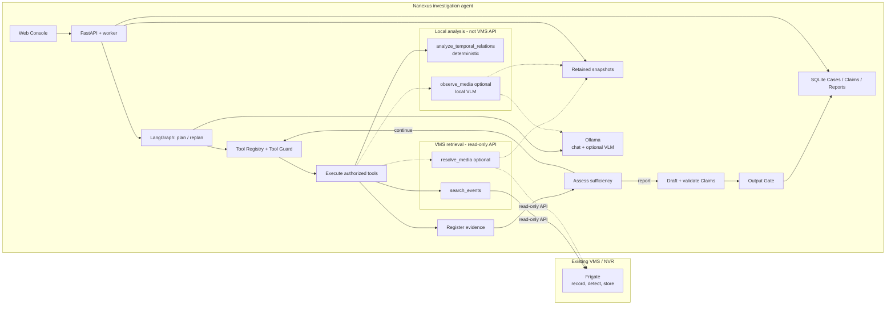

# Nanexus Local Video Investigation Agent

**Nanexus V0.1 — Local-First Video Investigation Agent (Developer / Technical Preview)**

Nanexus is an **independent investigation agent** that runs **alongside** an established VMS/NVR. It turns a natural-language question, authorized cameras, and a time window into an **evidence-grounded investigation report** — without modifying or replacing the VMS that already records, detects, and stores video.

V0.1 is Frigate-first today: Nanexus talks to Frigate over authenticated, **read-only** APIs. The VMS stays the operational foundation; Nanexus owns its own process, planning loop, evidence store, and Case lifecycle. The same side-by-side pattern is intended to support additional VMS platforms later; only Frigate is verified in this milestone.

The working product and the research goal are complementary. Nanexus explores **domain-specific AI Agent engineering** for video-surveillance investigation: natural-language planning, bounded guarded tool use, deterministic temporal analysis, selective local visual interpretation, and evidence-linked durable records. V0.1 is the first consolidated open-source technical milestone — a functional preview and foundation for continued exploration, not a finished commercial surveillance product.

## What Can You Investigate?

Enter a natural-language question in the Web Console, select authorized cameras, and set a historical time window. The examples below match capabilities exercised in V0.1 tests. Planner steps can vary. When an investigation produces an accepted report, that report stays bound to registered evidence — outcomes may also be `partial` or `failed`, with limitations disclosed.

**Shared boundaries for all examples:** Nanexus does not identify people, track identity across cameras, prove physical interaction from time proximity alone, or replace a full VMS/NVR. Gaps between detections are not proven absence. Visual captions are qualified model opinion over selectively retained snapshots — not independently verified scene truth.

### 1. Person and vehicle event discovery

```text
Find person detections in this camera and time window.
```
```text
Find vehicle detections in this camera and time window.
```
```text
Find all person and vehicle detections in the selected cameras and time window.
```

**You should get:** Qualified detections with camera, label, and time; a timeline of those events; findings that cite search evidence.
**Behind the scenes:** Authorized VMS event search (`search_events`; vehicle maps to Frigate label `car`).

### 2. Activity timeline within a camera / time scope

```text
List person activity on the authorized camera during this window and summarize the timeline.
```

**You should get:** An ordered timeline of person detections from authorized event metadata — useful for “what showed up when,” not a continuous video scrub.
**Behind the scenes:** Event search → registered observations → report timeline.

### 3. Nearby person / vehicle detections

```text
Find vehicle activity within three minutes before or after person detections on this camera.
```

**You should get:** Detections plus deterministic nearby-activity (NEAR) relations with gap timing. Operator wording states that proximity is temporal only.
**Behind the scenes:** Event search for the relevant labels, then local `analyze_temporal_relations` (example window: 180 seconds).

### 4. Selective visual inspection of an event snapshot

```text
Find a person detection in this camera and time window. Retrieve the event snapshot and use the local visual model to describe what is visible in the image.
```

**You should get:** A Case-bound, hash-checked snapshot when retrieval succeeds, plus a qualified local VLM description. Media is selective — not every detection is downloaded.
**Behind the scenes:** Event search → optional `resolve_media` (VMS API) → optional `observe_media` (local VLM).

### 5. Combined event, temporal, and visual investigation

```text
Find person and vehicle detections in this window, note any nearby activity within three minutes, and visually inspect a retained person-event snapshot when media is available.
```

**You should get:** A mixed report: detections, optional NEAR relations, and optional snapshot + caption when the planner selects media tools and media succeeds. Status may be `partial` when coverage is incomplete while prior evidence remains available.
**Behind the scenes:** Combines the tools above; the visual path is optional.

### 6. Evidence-grounded findings and reopenable Cases

Successful investigations yield an accepted report (`completed` or `partial`) with summary, findings, timeline, limitations, and expandable provenance. A run may also end as `failed` (for example if interrupted before finalization). Reopening a saved Case from Recent Cases restores the question, cameras, and times **without** calling Frigate or models again. Incomplete coverage and unresolved items are disclosed rather than silently finished as “nothing happened.”

### Example investigation output (synthetic fixture)

Illustrative report excerpt from a **synthetic fixture** (not a live recording). The NEAR gap uses the same interval semantics as the V0.1 temporal engine: the non-overlap gap between completed detection intervals — not the difference between timeline start times.

**Question:** `Find vehicle activity within three minutes before or after person detections on this camera.`

```text
Status: completed

Summary:
  Outcome (completed): found 2 authorized detection(s) on authorized cameras
  in the requested window — 1 car, 1 person. 1 nearby-activity (NEAR)
  relation(s) were established (temporal proximity only).

Timeline (detection intervals):
  2026-10-10 12:00:00–12:00:15 UTC  person  camera-a
  2026-10-10 12:01:24–12:01:34 UTC  car     camera-a

Finding:
  Temporal proximity — person and car detection intervals 69s apart
  (within 180s).

Qualification (shown once when NEAR relations are present):
  Nearby-activity (NEAR) means temporal proximity only — not interaction,
  identity, ownership, or causation.
```

Here the timeline start times differ by 84 seconds, while the reported NEAR gap is **69 seconds** — the non-overlap gap from the end of the person interval (`12:00:15`) to the start of the car interval (`12:01:24`), matching `gap_seconds` in the temporal engine.

---

## How Nanexus Works

Nanexus and the VMS are **separate systems**. The established VMS/NVR keeps recording, detection, and storage. Nanexus deploys independently, plans investigations locally, and reaches the VMS only through a **read-only authenticated API** boundary. V0.1 verifies that pattern with Frigate; other VMS adapters are a direction for later work, not a claim of current multi-VMS support.

Inside Nanexus, **one** LangGraph investigation controller owns the Agent loop. The Web UI is a thin FastAPI front door: it admits a Case, runs that controller, and presents durable artifacts. The browser never talks to the VMS or Ollama directly.



**How to read the diagram**

- **Left:** the existing VMS/NVR (Frigate) remains responsible for recording, detection, and primary storage.
- **Right:** Nanexus runs independently — Web Console, LangGraph controller, Tool Guard, evidence/Claims, Output Gate, and durable Case storage.
- **VMS retrieval group:** only `search_events` and optional `resolve_media` cross the authenticated read-only API boundary.
- **Local analysis group:** `analyze_temporal_relations` is deterministic computation over registered observations; optional `observe_media` is local VLM inference — neither is a VMS write or core-VMS replacement.
- **Dashed paths:** selective visual work; ordinary event or temporal investigations often never retrieve snapshots or call the VLM.

### Investigation progress

1. **Admit Case** — question, authorized cameras, UTC time bounds.
2. **Plan** — local chat model proposes the next authorized tool (or proceed to report).
3. **Guard + execute** — Tool Guard checks scope, budgets, and anti-repeat; tools run as authorized (VMS read-only API, local temporal analysis, and/or selective local VLM).
4. **Register** — Observations, EvidenceRefs, receipts, and temporal relations become Case artifacts.
5. **Loop or report** — sufficiency may continue searching or draft Claims.
6. **Output Gate** — only an evidence-grounded report is accepted for the operator outcome.
7. **Persist** — Case/Claim/Report land in Nanexus SQLite; snapshots stay Case-bound.
8. **Present / reopen** — Results are built from durable artifacts; reopen does not re-plan or re-query the VMS.

### Why this shape

| Choice | Rationale |
|--------|-----------|
| Side-by-side VMS + Agent | Keep the proven VMS as the recording/detection foundation; Nanexus adds investigation without replacing core VMS duties. |
| Bounded planning + Tool Guard | The LLM proposes; it cannot invent tools, widen cameras, or bypass budgets. |
| Deterministic temporal engine | NEAR/gap math stays separate from free-form model prose and from VMS retrieval. |
| Selective visual path | Snapshots and VLM cost are opt-in when the investigation needs them — not every event download. |
| Evidence-backed Claims | Report statements must cite receipts/evidence/relations the Output Gate can check. |
| Durable Cases | Operators can audit and reopen results without re-hitting the VMS or models. |

The milestone value is this **Agent engineering integration and evidence discipline** — natural-language planning over guarded tools — not a novel vision algorithm or a VMS rewrite.

## Core capabilities and evidence model

| ID | Capability |
|----|------------|
| **F1** | Natural-language investigation over authorized VMS detection/event metadata |
| **F2** | Nearby-activity analysis and deterministic temporal relationships |
| **F3** | Selective snapshot retrieval and qualified local VLM interpretation |
| **F4** | Persistent, evidence-linked Case reports with a single-page Web UI |

Keep these layers distinct when reading a report:

| Layer | What it is |
|-------|------------|
| VMS event metadata | Detections returned by the authorized API |
| Computed temporal relations | Deterministic proximity/ordering from registered observations |
| Local model interpretations | Qualified VLM text over retained snapshot bytes |
| Integrity checks | Case-bound media with content-hash verification when served |

### Supported vs not supported (V0.1)

**Supported well:** scoped event search, timelines, NEAR proximity with clear caveats, selective snapshot + qualified caption, durable reopenable Cases.

**Not supported / not claimed:** person identification, cross-camera Re-ID, proving physical interaction from time proximity alone, exhaustive frame-by-frame or clip-wide video understanding, advanced spatial or multi-camera scene understanding, replacing a full VMS/NVR.

## Web Investigation Console

`nanexus-web` serves one operator page: question, cameras, time range, Investigate, then same-page results (summary, findings, timeline, visual evidence, limitations, expandable provenance). Recent Cases (latest 10 listed) restore form + results without re-running the Agent.

Default bind: `http://127.0.0.1:8787` (localhost only). Operator detail: [docs/web-console.md](docs/web-console.md).

## Tested requirements (V0.1 baseline)

| Component | Tested baseline |
|-----------|-----------------|
| Python | 3.12 (`>=3.12,<3.13`) |
| Frigate | Authenticated API on port **8971**, Frigate **0.17.1** |
| Planning model | Local Ollama `qwen3:14b` |
| Vision model | Local Ollama `moondream:1.8b` (optional; for F3) |
| Persistence | SQLite domain DB + local retained-media store under `.local/` |

**Frigate compatibility:** Nanexus V0.1 was **verified** against authenticated Frigate **0.17.1**. That is a historical compatibility-test baseline — not a recommendation to run an unpatched upstream release indefinitely. For new installations, follow Frigate’s current security-maintained versions and your organization’s patch policy. Nanexus does **not** claim compatibility with Frigate versions that have not been verified here (including 0.18.x). Access uses supported authenticated APIs (not the unauthenticated internal port). Nanexus does not modify Frigate configuration, recordings, or runtime, and does not replace Frigate as the VMS.

## Quick Start

Requires [uv](https://docs.astral.sh/uv/) and Python 3.12. Install Ollama models separately on the investigation host.

```bash
git clone https://github.com/Nanexus-AI/nanexus-video-investigation-agent.git
cd nanexus-video-investigation-agent
# Runtime dependencies only (exact lockfile; omits the optional "dev" group)
uv sync --locked --no-dev
```


### Configuration

Frigate settings and Web/Ollama settings use **different** loading paths.

**1. Frigate (private file — `NANEXUS_FRIGATE_*`):**

```bash
mkdir -p .local
cp .env.example .local/frigate.env
# edit .local/frigate.env — set BASE_URL, cameras, ONE auth method, and CA bundle
# keep this file out of Git (.local/ is gitignored)
```

The Web process loads Frigate settings from the file named by **`NANEXUS_FRIGATE_ENV`** (default `.local/frigate.env`) and applies only **`NANEXUS_FRIGATE_*`** keys to the Frigate client. Frigate auth is one of: username+password, bearer token, or session cookie (see [`.env.example`](.env.example)). Copying the example file alone does **not** export Web/Ollama variables into the process.

**2. Web / Ollama (process environment — optional):**

Defaults are localhost-safe. To override bind address, DB paths, model names, or `NANEXUS_FRIGATE_ENV`, **export** variables in the shell (or `set -a; source your-web.env; set +a`) before starting.

### Start the Web Console

```bash
uv run --locked --no-dev nanexus-web
# then open http://127.0.0.1:8787/ in a browser
```

Check `GET /api/health`: `ok` means the Web process is up; `frigate.ready` / `ollama_*` report dependency readiness. Missing Frigate configuration yields `frigate.ready: false` with a clear detail string — not an HTTP 500.

Temporary LAN binding for UI review is **optional**, explicit, and **not** multi-user authentication. Prefer SSH tunneling to localhost when remote viewing is needed. See [docs/web-console.md](docs/web-console.md) for operator detail.

## Supported scope and limitations

- Snapshot retrieval is **selective**; ordinary event searches may not retain media
- Multi-snapshot investigations are only lightly exercised
- VLM text is **qualified model opinion**, not independently verified physical-world truth
- Conservative anti-repeat may leave a Case **PARTIAL** even after useful evidence was obtained
- One investigation runs at a time; interrupted runs are not auto-recovered
- Localhost-first access; no production multi-user authentication
- Frigate-first side-by-side integration; not a full NVR/VMS product or multi-VMS adapter suite
- No clip-wide video understanding or cross-camera identity matching

As-built notes: [docs/v0.1-as-built.md](docs/v0.1-as-built.md).

## Documentation

| Document | Purpose |
|----------|---------|
| [docs/v0.1-architecture-overview.md](docs/v0.1-architecture-overview.md) | Concise V0.1 architecture overview |
| [docs/web-console.md](docs/web-console.md) | Operator Web console guide |
| [docs/v0.1-as-built.md](docs/v0.1-as-built.md) | Verified V0.1 implementation summary |
| [`.env.example`](.env.example) | Configuration key template |

## Project Direction

V0.1 is an **initial technical milestone**: a usable local preview of a Frigate-first, side-by-side investigation Agent with evidence discipline. Continued work explores domain-specific security investigation agents, including questions such as:

- Which temporal and spatial relationships between detected objects are meaningful in security operations?
- How should an Agent investigate those relationships under bounded tools and operator trust requirements?
- How should evidence, model interpretation, and uncertainty stay clearly distinguished in reports?

Advanced spatial reasoning and multi-camera understanding are **research directions**, not capabilities shipped in V0.1.

**Contributions and conversation are welcome.** Security practitioners: share real investigation problems and operational needs. AI Agent and VMS developers: contribute technical ideas, feedback, and evaluation approaches. This project does not commit to specific features or release dates.

## License

This project’s **source code** is licensed under the **Apache License 2.0**. See [LICENSE](LICENSE) and [NOTICE](NOTICE).

**Nanexus logo redistribution:** The original Nanexus logo may be included, displayed, copied, and redistributed with Nanexus software, documentation, source distributions, and wheels, including unmodified retention in downstream Nanexus distributions. See [NOTICE](NOTICE).

**Trademark reservation:** The Nanexus name and logo remain project trademarks. Logo redistribution permission does **not** authorize misleading claims of official status, affiliation, or endorsement, and does not transfer trademark ownership. Apache-2.0 terms for the source code are separate from these branding rules.

Third-party Python dependencies retain their own licenses and are installed from upstream distributors (typically PyPI); they are not vendored into Nanexus archives in this candidate.
